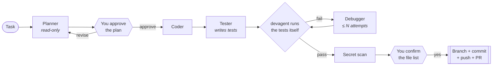

# devagent

[](https://github.com/Khyalddinniazi/devagent/actions/workflows/ci.yml)


**A command-line tool that turns one sentence into a tested GitHub pull request, using a team of
specialised AI agents that run inside a security sandbox.**

```bash
devagent run "add a slugify() helper with tests" --repo ~/code/myapp
```

devagent plans the change, waits for you to approve the plan, writes the code, writes tests, runs
them and fixes failures. It then shows you every file it changed and opens a pull request only after
you say yes. It never merges; that stays your decision.

<!-- DEMO VIDEO GOES HERE -->

## Why

AI coding assistants are powerful but hard to trust with a real repository. They can claim that
tests pass when they don't, quietly weaken tests, wander outside the project, or be hijacked by
instructions hidden in a file ("prompt injection"). devagent is built around one rule:

> **Everything the model controls is untrusted. Everything that touches the outside world is plain
> code, behind a human approval.**

## How it works



| Stage | Who | Can do |
|---|---|---|
| Plan | Planner agent | Read the repo only. Writes `plan.md` (steps, files, test strategy, acceptance criteria, risks) |
| Approve | **You** | Approve, edit in `$EDITOR`, or send feedback for a revised plan |
| Code | Coder agent | Edit files inside the repo |
| Test | Tester agent | Write tests. It may not change the implementation |
| Debug | Debugger agent | Fix the code using the failure output. It may not delete, skip or weaken tests |
| Ship | **Plain Python**, not an agent | Secret scan, then after your "yes": `git commit`, `git push`, `gh pr create` |

## Design decisions

| Decision | Why |
|---|---|
| **The stage order is a state machine in Python, not chosen by an LLM** | Runs are predictable, can be resumed after a crash (`devagent resume`), and are easy to test |
| **One agent per role, each with a fresh context** | Agents pass work through files (`plan.md`, test reports) instead of one huge conversation, so each one stays focused and has only the tools it needs (least privilege) |
| **"Tests pass" is decided by running them, not by asking the model** | Models sometimes say "all tests pass" when they don't. The pipeline re-runs the suite itself and parses the result |
| **Separate Tester and Debugger with anti-cheating rules** | The agent that writes the tests isn't the one trying to make them pass, so tests aren't quietly weakened ("reward hacking") |
| **Deploy is plain code behind a human gate** | Pushing to GitHub is outward-facing and can't be undone, so no model decides when it happens |
| **Defence in depth** | Prompt rules → a guard hook on every tool call → an OS sandbox → a secret scan → human gates. Each layer covers the weakness of another |
| **Dependency injection** | The agent runner, approval gates and test runner are passed in, so the whole pipeline is tested with a scripted fake runner and no API calls |

## Security

devagent gives AI agents a shell, so security is a core feature, not an afterthought. The full
analysis is in **[docs/THREAT_MODEL.md](docs/THREAT_MODEL.md)**: assets, threat actors, trust boundaries,
12 threats with their mitigations, evidence, and the known gaps.

| Risk | Protection |
|---|---|
| A tricked agent runs harmful commands | Agent commands run in the **Claude Code OS sandbox**: writes only inside the repo, **no network**, no sandbox escape. A guard hook also blocks `git push`, `gh`, `sudo`, `rm -rf` outside the repo, `curl \| sh` and more |
| Tests run code an agent could have planted | Test commands run inside **macOS `sandbox-exec`**: no internet (localhost allowed), limited writes, credential folders unreadable |
| Prompt injection | All file content is treated as data. Attempts are reported as `INJECTION-ALERT:` and shown at the deploy prompt. Web tools are disabled |
| A malicious repo ships its own `.claude` settings or hooks | Not loaded unless you pass `--trust-project` |
| Credential theft | `~/.ssh`, `~/.aws`, `~/.config/gh`, the Keychain, `.env*` and key files are blocked by the guard, the sandbox and permission deny rules |
| Secrets pushed to GitHub | Every changed file is scanned for private keys and API tokens (AWS, GitHub, Anthropic, OpenAI, Slack, Google, Stripe). If anything is found, deploy is refused |
| Runaway cost | A spending limit for the whole run (`--max-cost`, default $5), enforced in every stage |
| Untested code shipped unseen | No test suite → the run is labelled **NOT TESTED**. With `--yes`, it's never deployed unless you pass `--allow-untested` |

These defences are **tested by attacking them**: [tests/test_redteam.py](tests/test_redteam.py) plants
malicious test code (data exfiltration, persistence in the home folder, credential reads, child
processes) and checks that it's contained. A control run confirms that the same attacks **succeed
without the sandbox**, so the sandbox really is what stops them. Known gaps in the guard are pinned
by tests too, so the documentation can't go stale.

## Benchmark

15 coding tasks (10 features, 5 bug fixes), each graded by **hidden tests that devagent never sees**.
Every task is checked in CI to be fair: the hidden tests fail before the change and pass with a reference
solution. Details and method: [bench/](bench/).

| Solved | Total cost | Cost per task (median) | Time per task (median) | False success |
|---|---|---|---|---|
| **15/15** | $6.05 | $0.39 | 1.2 min | 0 |

These are small, well-specified tasks, so 100% is a ceiling rather than a ranking. A harder tier is on the roadmap.

## Quick start

Requirements: macOS or Linux, Python ≥ 3.10, [uv](https://docs.astral.sh/uv/), the
[GitHub CLI](https://cli.github.com/) (`gh`), and either `ANTHROPIC_API_KEY` or a Claude Code login.

```bash
git clone https://github.com/Khyalddinniazi/devagent && cd devagent
uv venv -p 3.12 .venv && uv pip install -p .venv -e ".[dev]"
gh auth login                       # only needed for the deploy stage

make demo-repo                      # copies examples/sample_repo to /tmp/devagent-demo as its own git repo
.venv/bin/devagent run "add a slugify(text) function with tests" --repo /tmp/devagent-demo --no-deploy
```

## Usage

```bash
devagent run "add rate limiting to the /login endpoint" --repo ~/code/myapp
devagent run "..." --no-deploy          # stop when tests pass; leave changes uncommitted
devagent run "..." --yes                # skip both approval gates (CI)
devagent status --repo ~/code/myapp     # list runs
devagent resume <run-id> --repo ...     # continue from the last completed stage
```

| Option | Meaning |
|---|---|
| `--max-debug N` | Debugger attempts before giving up (default 3) |
| `--base BRANCH` · `--test-command CMD` · `--model ID` | Override detection and defaults |
| `--max-cost USD` | Spending limit for the whole run (default 5) |
| `--allow-network DOMAIN` | Let agents reach one domain, for example `pypi.org` (repeatable) |
| `--allow-untested` | With `--yes`, allow deploying when there's no test suite |
| `--trust-project` | Load the repo's own `.claude` settings |
| `--no-sandbox` | ⚠️ Turn off the sandboxes, for troubleshooting only |

If a project has no test suite (for example a plain HTML site), devagent detects that, skips the Tester
and labels the run **NOT TESTED** at the send prompt and in the PR.

Per-repo config goes in `.devagent.toml`:

```toml
test_command = "pytest -q -rf"
max_debug = 3
base_branch = "main"
max_cost_usd = 3.0
allowed_domains = ["pypi.org", "files.pythonhosted.org"]   # only if agents must install packages
[coder]
model = "claude-opus-5-5"
max_turns = 80
effort = "xhigh"
```

The artifacts of each run (plan, each agent's summary, test report, debug log, state) are saved in
`<repo>/.devagent/<run-id>/`. That folder is added to `.git/info/exclude`, so it's never committed.

## Project layout

| Path | Role |
|---|---|
| [devagent/pipeline.py](devagent/pipeline.py) | State machine, approval gates, debug loop, budget, deploy checks |
| [devagent/runner.py](devagent/runner.py) | Claude Agent SDK wrapper: per-agent options, sandbox, hooks, live tool output, cost |
| [devagent/agents/](devagent/agents/) | One system prompt, tool set and prompt builder per agent |
| [devagent/tools/project_tools.py](devagent/tools/project_tools.py) | Test detection and `run_tests` (also exposed to agents as an in-process MCP tool) |
| [devagent/security.py](devagent/security.py) | Sandbox profiles, sensitive-path rules, secret scanner |
| [devagent/guards.py](devagent/guards.py) | PreToolUse guard run before every tool call |
| [devagent/deploy.py](devagent/deploy.py) | Preflight checks, git and `gh` |
| [docs/THREAT_MODEL.md](docs/THREAT_MODEL.md) | Security analysis |

## Development

```bash
make check     # ruff lint + format check, mypy, pytest
```

107 tests cover the pipeline (with a scripted fake runner), guards, test parsing, secret scanning, git
operations against temporary repos, real `sandbox-exec` checks, the red-team suite and the fairness of every benchmark task. None of them
call the API. CI runs everything on Linux and macOS.

## Limitations

- Your code is sent to Anthropic's API so Claude can work on it. Only run devagent on code you're allowed to share.
- The test sandbox (`sandbox-exec`) is macOS-only. On Linux, agent commands are still sandboxed, but test runs aren't.
- Prompt injection can't be fully prevented. devagent limits what a hijacked agent can reach, and you review the plan, the file list and the PR.

## Roadmap

- [x] Benchmark with hidden tests: 15/15 solved, $0.39 median per task
- [ ] Harder benchmark tier: multi-file changes, vague bug reports, larger codebases
- [ ] GitHub Action: label an issue → devagent opens a PR
- [ ] Docker runner, which also gives sandboxed test runs on Linux

## License

[MIT](LICENSE)
