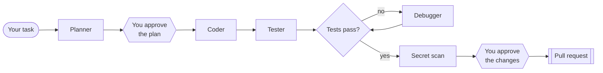

# devagent

[](https://github.com/Khyalddinniazi/devagent/actions/workflows/ci.yml)


**Turn one sentence into a tested GitHub pull request, using a team of AI agents in a security sandbox.**


<sub>A real run, sped up 2×.</sub>

## How it works



| Step | Who does it | What happens |
|---|---|---|
| Plan | Planner agent | Reads the project (read-only) and writes a plan |
| Code | Coder agent | Makes the change |
| Test | Tester agent | Writes tests for the change |
| Debug | Debugger agent | Fixes failures. It may not delete or weaken tests |
| Open the PR | Plain code, after your "yes" | Scans for secrets, pushes a branch and opens the PR |

A fifth agent writes the PR description. **devagent never merges**: that stays your decision.

## Why you can trust the result

- **Tests are run by code, not judged by the AI.** devagent runs them itself and reads the result.
- **Agents are sandboxed.** They can't reach the internet, write outside the project or read your credentials.
- **Only plain code touches GitHub**, and only after you approve.

Details: [threat model](docs/THREAT_MODEL.md).

## Quick start

You need macOS or Linux, [uv](https://docs.astral.sh/uv/), the [GitHub CLI](https://cli.github.com/), and a Claude Code login or an `ANTHROPIC_API_KEY`.

```bash
git clone https://github.com/Khyalddinniazi/devagent && cd devagent
uv venv -p 3.12 .venv && uv pip install -p .venv -e ".[dev]"
gh auth login

make demo-repo    # creates a practice project
.venv/bin/devagent run "add a slugify(text) function with tests" --repo /tmp/devagent-demo --no-deploy
```

Remove `--no-deploy` to open a real PR. All options: [usage guide](docs/USAGE.md).

## Benchmark

15 coding tasks, graded by hidden tests that devagent never sees ([method](bench/)):

| Solved | Median cost per task | Median time per task | False successes |
|---|---|---|---|
| **15/15** | $0.39 | 1.2 min | 0 |

The tasks are small and clearly specified, so 100% shows reliability on simple work, not a ranking. Costs are API-equivalent: on a Claude subscription, runs count toward your plan's limits instead.

## GitHub Action

Add the label `devagent` to an issue, and devagent opens a PR for it. [See a live example](https://github.com/Khyalddinniazi/devagent-action-test/issues/1) · [setup guide](docs/GITHUB_ACTION.md)

## Learn more

[Architecture and design decisions](docs/ARCHITECTURE.md) · [Usage guide](docs/USAGE.md) · [Threat model](docs/THREAT_MODEL.md) · [Benchmark](bench/)

Your code is sent to Anthropic's API so Claude can work on it, so only use devagent on code you're allowed to share.

## License

[MIT](LICENSE)
